

<picture>
  <source media="(prefers-reduced-motion: reduce)" srcset="./assets/pixel-art/hero/hero-still.png" />
  
</picture>

<a href="https://kaustuvmohapatra.github.io/ResumeSite/"><picture><source media="(prefers-reduced-motion: reduce)" srcset="./assets/pixel-art/buttons/button-portfolio-still.png" /></picture></a>
<a href="https://kaustuvm.itch.io/"><picture><source media="(prefers-reduced-motion: reduce)" srcset="./assets/pixel-art/buttons/button-play-still.png" />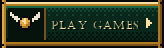</picture></a>
<a href="https://github.com/KaustuvMohapatra?tab=repositories"><picture><source media="(prefers-reduced-motion: reduce)" srcset="./assets/pixel-art/buttons/button-github-still.png" /></picture></a>
<a href="https://www.linkedin.com/in/kaustuv-mohapatra-b0538428b/"><picture><source media="(prefers-reduced-motion: reduce)" srcset="./assets/pixel-art/buttons/button-linkedin-still.png" />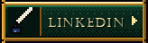</picture></a>
<a href="mailto:kaustuv4@outlook.com"><picture><source media="(prefers-reduced-motion: reduce)" srcset="./assets/pixel-art/buttons/button-owl-still.png" />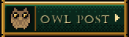</picture></a>

<h3>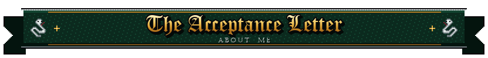</h3>

<h3>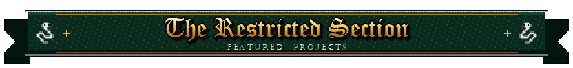</h3>

<a href="https://github.com/KaustuvMohapatra/EchosSim"><picture><source media="(prefers-reduced-motion: reduce)" srcset="./assets/pixel-art/projects/prophet-echosim-still.png" />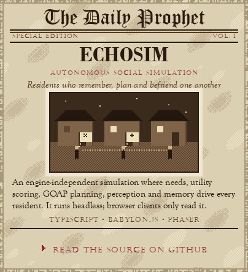</picture></a>
<a href="https://kaustuvm.itch.io/arena-survivor"><picture><source media="(prefers-reduced-motion: reduce)" srcset="./assets/pixel-art/projects/prophet-arena-survivor-still.png" />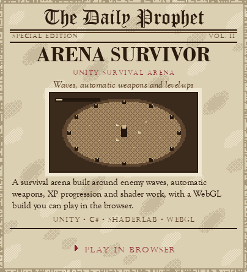</picture></a>
<picture><source media="(prefers-reduced-motion: reduce)" srcset="./assets/pixel-art/projects/prophet-reload-still.png" />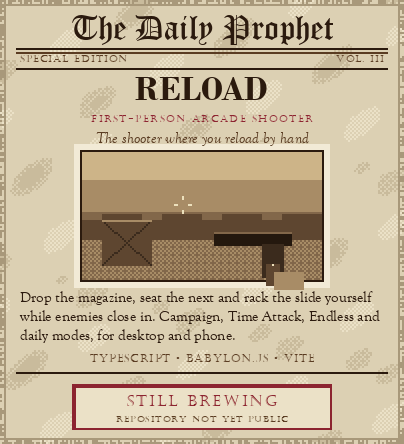</picture>
<picture><source media="(prefers-reduced-motion: reduce)" srcset="./assets/pixel-art/projects/prophet-medieval-hauler-still.png" />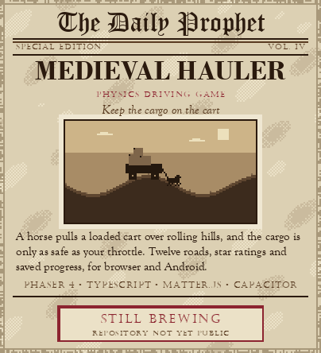</picture>

<b>From the library archive</b> 
<a href="https://github.com/KaustuvMohapatra/AI-Game-Asset-Maker">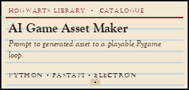</a>
<a href="https://medlingo-pied.vercel.app/">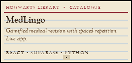</a>
<a href="https://github.com/KaustuvMohapatra/AlexAI">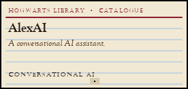</a>

<b>Read the Restricted Section in plain text</b>

### EchoSim
**Autonomous social simulation** · TypeScript · Babylon.js · Phaser

An engine-independent simulation where residents pursue goals, remember experiences, revise beliefs and form relationships. Needs, utility scoring, GOAP planning, perception and memory drive behaviour; the simulation runs headless and the browser clients only read from it.
[Source & architecture →](https://github.com/KaustuvMohapatra/EchosSim)

### Arena Survivor
**Unity survival arena** · Unity · C# · ShaderLab · WebGL

A playable arena built around enemy waves, automatic weapons, XP progression, level-ups and shader work, with a WebGL build you can play in the browser.
[Play in browser →](https://kaustuvm.itch.io/arena-survivor) · [Source →](https://github.com/KaustuvMohapatra/Arena-Survivor)

### RELOAD (in development)
**First-person arcade shooter for desktop and phone** · TypeScript · Babylon.js · Vite

A browser shooter about reloading by hand under pressure: drop the magazine, seat the next one and rack the slide yourself while enemies close in. Campaign, Time Attack, Endless and daily challenge modes. The repository isn't public yet.

### Medieval Hauler (in development)
**Physics driving game** · Phaser 4 · TypeScript · Matter.js · Capacitor

A horse pulls a loaded cart over rolling hills, and the cargo is only as safe as your throttle. Twelve roads, star ratings and saved progress, for browser and Android. The repository isn't public yet.

### From the archive
- **AI Game Asset Maker**: prompt → generated asset → playable Pygame loop (Python · FastAPI · Electron). [Source](https://github.com/KaustuvMohapatra/AI-Game-Asset-Maker)
- **MedLingo**: gamified medical revision with spaced repetition (React · Supabase · Python). [Live app](https://medlingo-pied.vercel.app/) · [Source](https://github.com/KaustuvMohapatra/MedLingo)
- **AlexAI**: a conversational AI assistant. [Source](https://github.com/KaustuvMohapatra/AlexAI)

<h3>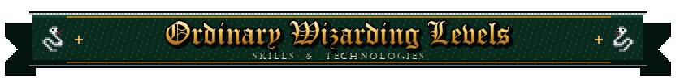</h3>

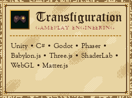
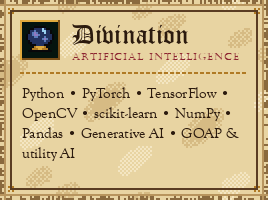
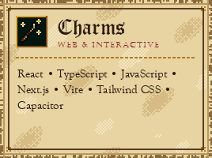
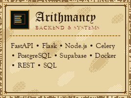
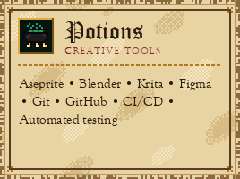

<h3>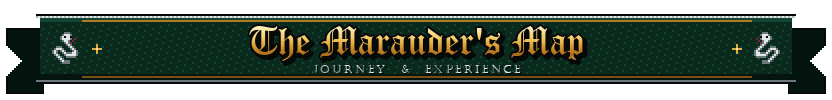</h3>

<picture>
  <source media="(prefers-reduced-motion: reduce)" srcset="./assets/pixel-art/journey/marauders-map-still.png" />
  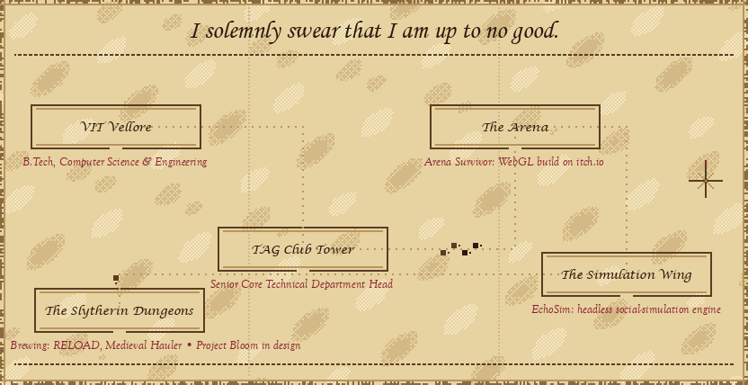
</picture>

<b>Read the map in plain text</b>

- **VIT Vellore**: B.Tech in Computer Science and Engineering.
- **TAG Club, VIT**: Senior Core Technical Department Head, leading technical development and collaboration.
- **Arena Survivor**: shipped a browser-playable WebGL build on [itch.io](https://kaustuvm.itch.io/arena-survivor).
- **EchoSim**: built a headless social-simulation engine with explainable planning and several interactive clients.
- **Now brewing**: RELOAD and Medieval Hauler in development; Project Bloom, a cozy exploration game, in design.

**Skills:** Unity · C# · Godot · Phaser · Babylon.js · Three.js · ShaderLab · WebGL · Python · PyTorch · TensorFlow · OpenCV · scikit-learn · React · TypeScript · Next.js · FastAPI · Flask · Node.js · PostgreSQL · Supabase · Docker · Aseprite · Blender · Figma

<h3>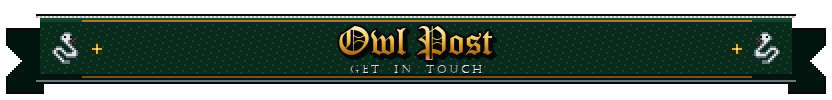</h3>

<a href="mailto:kaustuv4@outlook.com"><picture>
  <source media="(prefers-reduced-motion: reduce)" srcset="./assets/pixel-art/contact/owl-post-still.png" />
  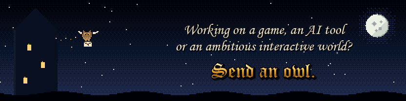
</picture></a>

<a href="https://kaustuvmohapatra.github.io/ResumeSite/"><picture><source media="(prefers-reduced-motion: reduce)" srcset="./assets/pixel-art/buttons/button-portfolio-still.png" /></picture></a>
<a href="https://kaustuvm.itch.io/"><picture><source media="(prefers-reduced-motion: reduce)" srcset="./assets/pixel-art/buttons/button-play-still.png" /></picture></a>
<a href="https://github.com/KaustuvMohapatra?tab=repositories"><picture><source media="(prefers-reduced-motion: reduce)" srcset="./assets/pixel-art/buttons/button-github-still.png" /></picture></a>
<a href="https://www.linkedin.com/in/kaustuv-mohapatra-b0538428b/"><picture><source media="(prefers-reduced-motion: reduce)" srcset="./assets/pixel-art/buttons/button-linkedin-still.png" /></picture></a>
<a href="mailto:kaustuv4@outlook.com"><picture><source media="(prefers-reduced-motion: reduce)" srcset="./assets/pixel-art/buttons/button-owl-still.png" /></picture></a>

An unofficial fan tribute. Harry Potter and Hogwarts are trademarks of Warner Bros. Entertainment; this profile is not affiliated with or endorsed by them. All artwork is original.

