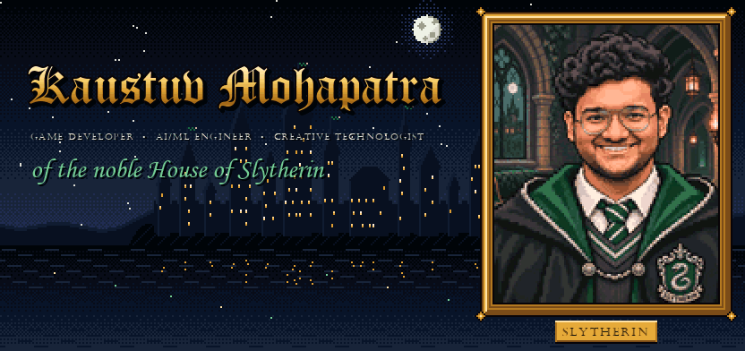
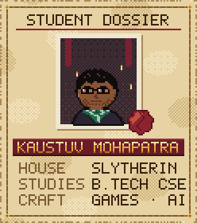
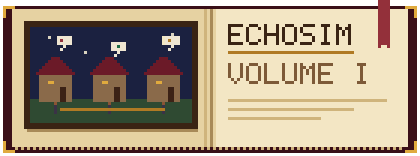
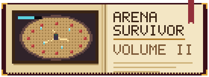
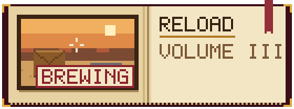
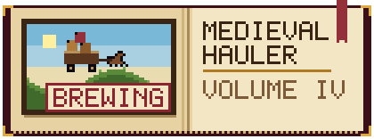
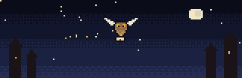

<picture>
  <source media="(prefers-reduced-motion: reduce)" srcset="./assets/pixel-art/hero/hero-still.png" />
  
</picture>

**Game Developer · AI/ML Engineer · Creative Technologist**

*Sorted into Slytherin. I build games, AI systems and interactive worlds.*

[**Portfolio ↗**](https://kaustuvmohapatra.github.io/ResumeSite/) &nbsp;·&nbsp; [**Play my games ↗**](https://kaustuvm.itch.io/) &nbsp;·&nbsp; [**Repositories ↗**](https://github.com/KaustuvMohapatra?tab=repositories) &nbsp;·&nbsp; [**LinkedIn ↗**](https://www.linkedin.com/in/kaustuv-mohapatra-b0538428b/)

## The Wizard's Dossier

I'm a **Computer Science undergraduate at VIT Vellore**, working where **game development, applied AI and interactive software** meet.

I build autonomous simulations, playable games and creative AI tools: residents who remember and form relationships, combat that feels responsive, and pipelines that turn a prompt into something playable. What connects them is the space between **technical depth and experiences that feel good to use**.

**Interested in:** gameplay programming · AI agents · emergent simulation · human-centred interfaces · creative tooling.

## Featured Creations

### EchoSim
**Autonomous social simulation** · TypeScript · Babylon.js · Phaser

An engine-independent simulation where residents pursue goals, remember experiences, revise beliefs and form relationships. Needs, utility scoring, GOAP planning, perception and memory drive behaviour; the simulation runs headless and the browser clients only read from it.
[**Source & architecture →**](https://github.com/KaustuvMohapatra/EchosSim)

### Arena Survivor
**Survival arena** · Unity · C# · ShaderLab · WebGL

A playable arena built around enemy waves, automatic weapons, XP progression, level-ups and shader work, with a WebGL build you can play in the browser.
[**Play in browser →**](https://kaustuvm.itch.io/arena-survivor) &nbsp;·&nbsp; [**Source →**](https://github.com/KaustuvMohapatra/Arena-Survivor)

### RELOAD &nbsp;in development
**First-person arcade shooter for desktop and phone** · TypeScript · Babylon.js · Vite

A browser shooter about reloading by hand under pressure: you drop the magazine, seat the next one and rack the slide yourself while enemies close in. It has a three-facility campaign, Time Attack, Endless and daily challenge modes, and S–D run rankings. Every weapon, enemy and level is built in code.
The repository isn't public yet.

### Medieval Hauler &nbsp;in development
**Physics driving game** · Phaser 4 · TypeScript · Matter.js · Capacitor

A horse pulls a loaded cart over rolling hills, and the cargo is only as safe as your throttle control. It has twelve roads, star ratings and saved progress, and is built for the browser and Android.
The repository isn't public yet.

#### From the archive

| Project | What it is | Explore |
| :--- | :--- | :--- |
| **AI Game Asset Maker** | Prompt → generated asset → playable Pygame loop (Python · FastAPI · Electron) | [Source](https://github.com/KaustuvMohapatra/AI-Game-Asset-Maker) |
| **MedLingo** | Gamified medical revision with spaced repetition (React · Supabase · Python) | [Live app](https://medlingo-pied.vercel.app/) · [Source](https://github.com/KaustuvMohapatra/MedLingo) |
| **AlexAI** | Conversational AI assistant | [Source](https://github.com/KaustuvMohapatra/AlexAI) |

## The Spellbook of Skills

###  Gameplay Engineering
Unity · C# · Godot · Phaser · Babylon.js · Three.js · ShaderLab · WebGL · Matter.js · gameplay architecture

###  Artificial Intelligence
Python · PyTorch · TensorFlow · OpenCV · scikit-learn · NumPy · Pandas · generative AI · agent planning (GOAP, utility AI)

###  Web & Interactive Systems
React · TypeScript · JavaScript · Next.js · Vite · Tailwind CSS · Capacitor

###  Backend & Systems
FastAPI · Flask · Node.js · Celery · PostgreSQL · Supabase · Docker · REST APIs · SQL

###  Creative Tools
Aseprite · Blender · Krita · Figma · Git · GitHub · CI/CD · automated testing

## The Adventure Log

- **VIT Vellore**: B.Tech in Computer Science and Engineering.
- **TAG Club, VIT**: Senior Core Technical Department Head, leading technical development and collaboration.
- **Arena Survivor**: shipped a browser-playable WebGL build on [itch.io](https://kaustuvm.itch.io/arena-survivor).
- **EchoSim**: built a headless social-simulation engine with explainable planning and several interactive clients.
- **Now brewing**: RELOAD and Medieval Hauler in development; Project Bloom, a cozy exploration game, in design.

## Send an Owl

<picture>
  <source media="(prefers-reduced-motion: reduce)" srcset="./assets/pixel-art/animations/send-an-owl-still.png" />
  
</picture>

Working on a game, an AI application or an ambitious interactive experience? I'd love to hear about it.

[**Portfolio**](https://kaustuvmohapatra.github.io/ResumeSite/) · [**Playable games (itch.io)**](https://kaustuvm.itch.io/) · [**GitHub**](https://github.com/KaustuvMohapatra) · [**LinkedIn**](https://www.linkedin.com/in/kaustuv-mohapatra-b0538428b/) · [**Email**](mailto:kaustuv4@outlook.com)

An unofficial fan tribute: all pixel art is original and made for this profile. Harry Potter and related names are trademarks of Warner Bros. Entertainment Inc.; this page has no affiliation with or endorsement from Warner Bros. or J.K. Rowling.

